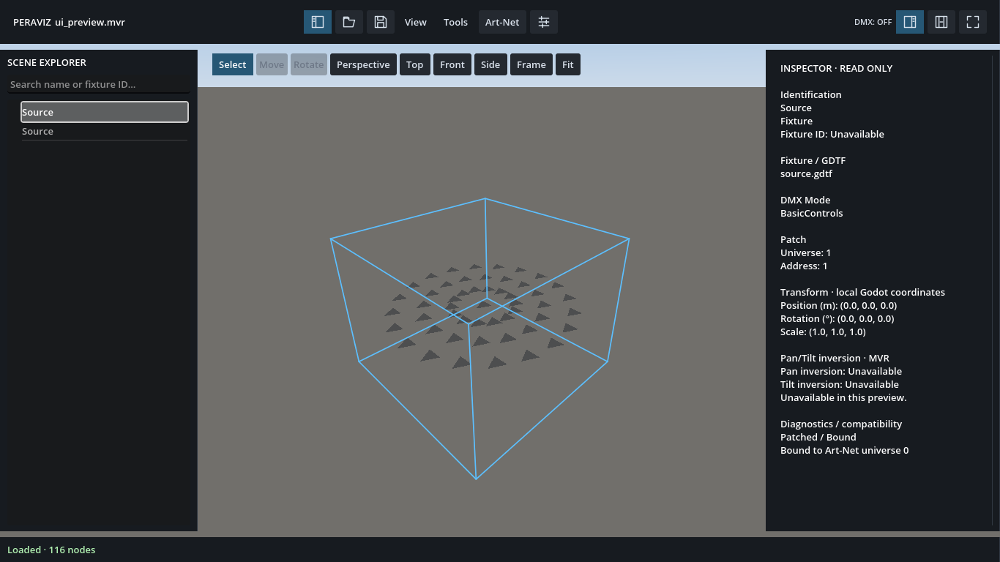
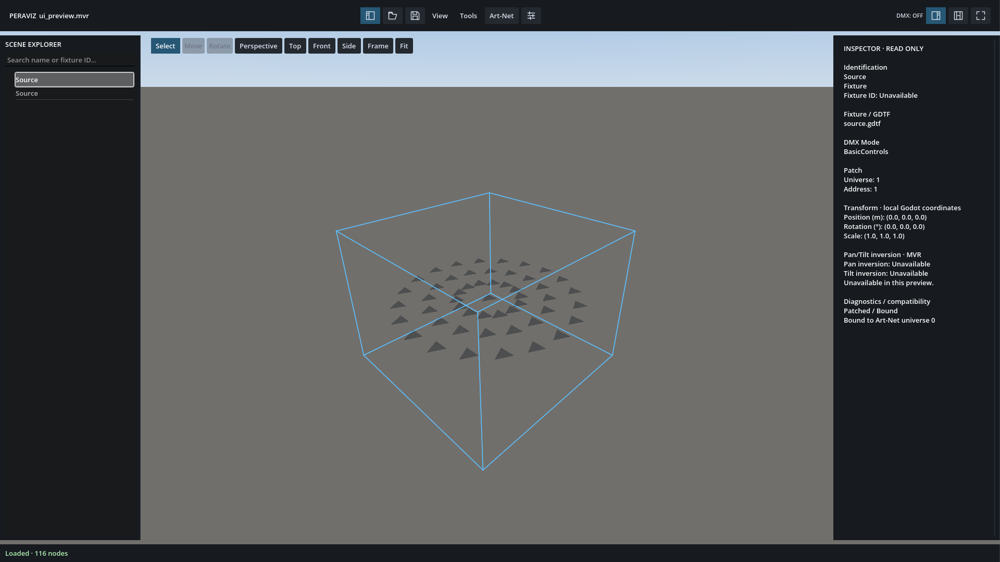
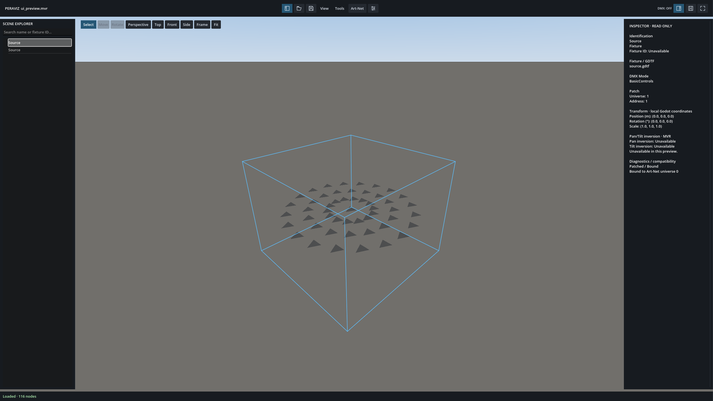
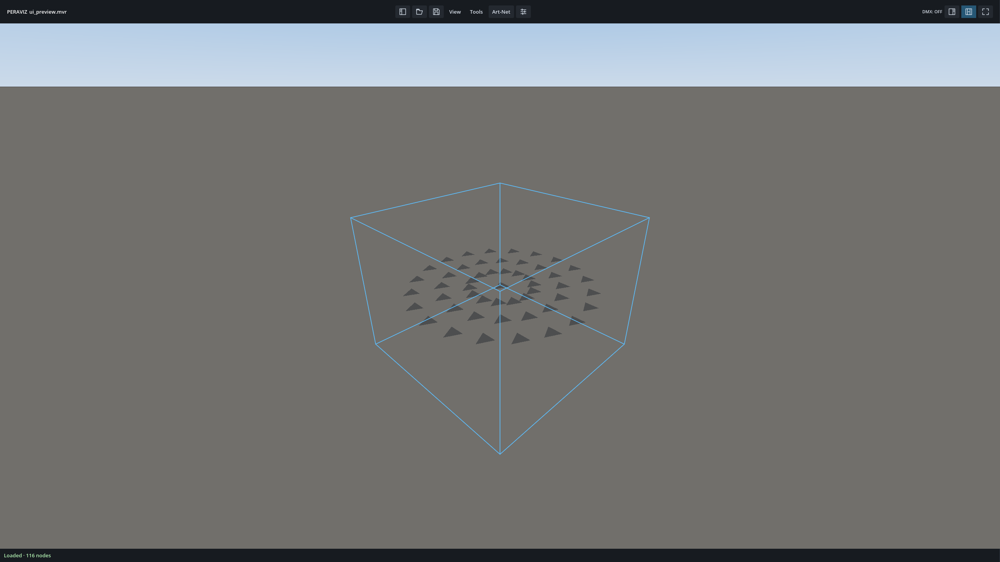

# Application UI validation

Tested on Linux with pinned Godot **4.7.1.stable.a13da4feb**, the Debug native
extension and the repository's retained CMake/vcpkg toolchain. The base is
`e931288` (PR #135). No large-MVR import investigation or runtime semantic change
was performed.

## Automated checks

The shell tests exercise legacy preference migration, both panels, divider
width restoration, Hide Tools, fullscreen mode/geometry restoration, a
1366×768/1920×1080/2560×1440 × 100%/125%/150% logical UI scale matrix, hierarchy,
explorer/viewport selection synchronization, empty/multiple selections, missing
GDTF properties, text-input shielding, Art-Net start/stop and visible state,
diagnostic windows, Escape, and scene retirement. The normal Inspector hides
UUIDs; the explicit technical identity option exposes them. The separate
selection test builds a 5,001-item explorer without per-row Controls and verifies
filtering, ownership and frame bounds excluding shafts.

Commands use a small local `work/godot-tests` wrapper to select the pinned
executable, writable XDG config/cache directories and isolated user preferences;
no source dependencies or lockfiles were changed to configure the environment.

```bash
export PATH=/workspace/.peraviz-tools/python/bin:$PATH
export XDG_CACHE_HOME=/workspace/.peraviz-tools/cache
export XDG_DATA_HOME=/workspace/.peraviz-tools/data
export XDG_CONFIG_HOME=/workspace/.peraviz-tools/config
export VCPKG_MAX_CONCURRENCY=5

cmake -S native -B native/build -DVCPKG_MANIFEST_INSTALL=ON \
  -DGODOTCPP_BUILD_PROFILE=/workspace/.peraviz-tools/godot-build-profile.json
cmake --build native/build --parallel 5
ctest --test-dir native/build --output-on-failure --timeout 120

work/godot --headless --audio-driver Dummy --rendering-method gl_compatibility \
  --path . --editor --import --quit
python3 .github/scripts/run_gdscript_tests.py \
  --godot /workspace/Peraviz/work/godot-tests --project /workspace/Peraviz \
  --output /workspace/Peraviz/work/validation/gdscript-final --timeout 60

bash tests/check_no_large_files.sh
bash tests/check_runtime_architecture.sh
git diff --check
```

The local Godot C++ build profile initially lacked existing production classes
`RenderingServer`, `Light3D` and `MeshInstance3D`; adding them to the local,
untracked profile regenerated the required bindings. The initial dependency
configuration and missing binary failures were resolved before the final checks.
The system `godot` command points to 4.6.3 and was not used for final validation.

The native suite passes **15/15**. The complete GDScript suite passes **60/60**;
this includes existing scene readiness/import, project policy, visual settings,
model detail, runtime, temporal and renderer regressions. The full runner rejects
unexpected Godot errors and leaks even when a process returns zero. Size checks
pass with pre-existing warnings for large runtime/loader files; architecture and
whitespace checks pass. Detailed local logs are under `work/validation`.

## Actual rendered UI

The images below are captures from the real Godot application using a synthetic
MVR generated by `tests/integration/generate_render_group_fixture.py` (two fixture
instances). These are **Linux OpenGL Compatibility/llvmpipe** UI captures. This
environment has no Vulkan surface/driver support; Forward+ initially fell back
to OpenGL. Custom Footprints correctly reports that it needs Forward+ and is
unavailable in these graphical captures. The images are evidence of UI layout,
loaded geometry, contextual inspection and visibility, not production Forward+
rendering equivalence or GPU performance. No warnings were suppressed.









The graphical command uses an isolated Xorg dummy display, since the managed
shared desktop advertised availability but exposed no desktop JavaScript/viewer
tool in this session:

```bash
DISPLAY=:17 work/godot --audio-driver Dummy --rendering-method gl_compatibility \
  --path . --script work/capture_ui.gd
DISPLAY=:17 work/godot --audio-driver Dummy --rendering-method gl_compatibility \
  --path . --script tests/gdscript/test_application_shell.gd
```

Windows DPI/window-manager behavior, Windows fullscreen child-window handling,
physical Art-Net reception, live MVR-xchange discovery/join/update and large show
performance comparisons require owner validation. Follow the reproducible
[Windows checklist](application-ui.md#windows-manual-release-checklist).
No performance improvement is claimed.
