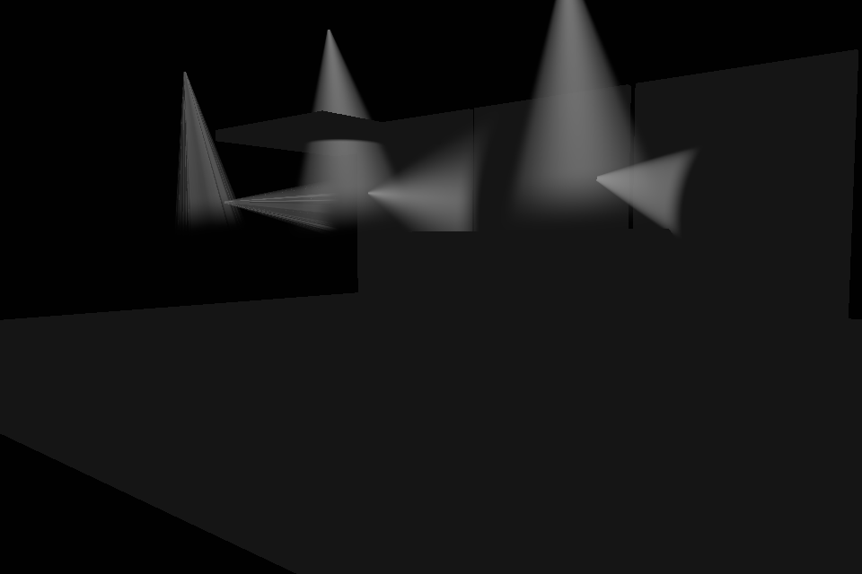
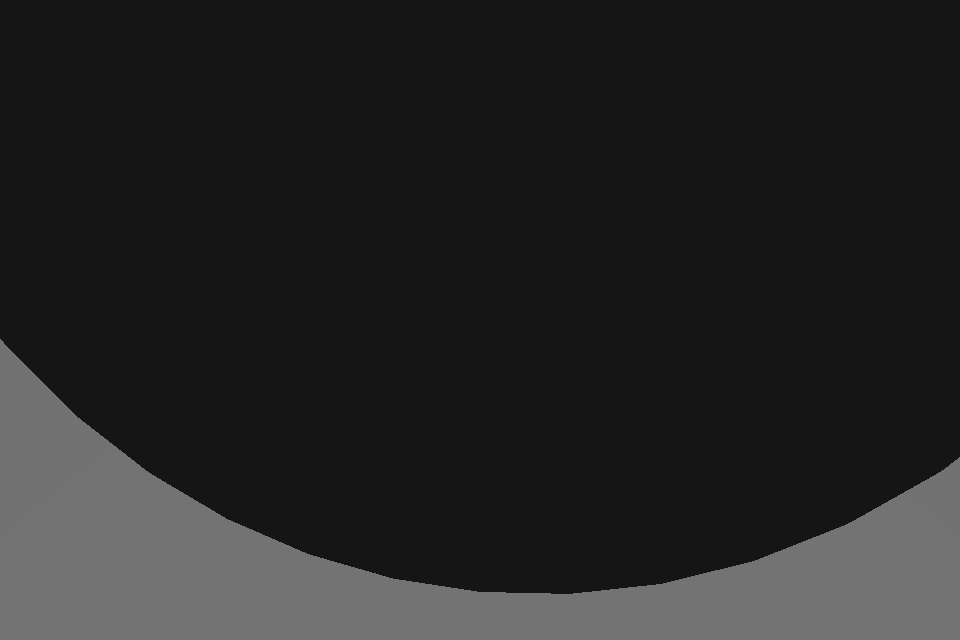

# Vector Gobo Prism light profile

Vector Gobo Prism remains the production/reference renderer. Native GDTF/DMX
semantics and PR #102's shared Optical Projection State remain authoritative.
This document describes the corrected presentation contract on the existing branch.

## Canonical data and provenance

Source of truth: [official GDTF Beam Geometry](https://www.gdtf.eu/gdtf/file-spec/geometry-collect/#geometry-type-beam).
Its defaults and BeamType definitions are retained; the standard 50% Beam / 10% Field
interpretation constrains our analytic interpolation, not a measured distribution.
No IES/EULUMDAT data are synthesized.

| Datum | Native compiler / manifest → presentation |
| --- | --- |
| BeamType, BeamAngle, FieldAngle | Selected-mode profile, values plus independent authored flags survive into `OpticalProjectionState` |
| BeamRadius | Official value/source survives; measured model aperture may be selected for presentation, with mismatch diagnostics |
| LuminousFlux | Raw/effective/source survive; native physical energy applies Dimmer once, renderer gain is separate |
| RectangleRatio | Value survives into the rectangular metric; separate authored flag is not exported |
| ThrowRatio | Value reaches native manifest but is not consumed by this angular projector; not silently interpreted as measured photometry |
| Zoom | Native selected-mode aperture updates use retained base tangent ratio for dynamic FieldAngle |

`runtime_scene_compiler.cpp` builds `CompiledBeamOpticalProfile`; `peraviz_loader.cpp`
exports it; `fixture_light_apply_service.gd` passes type, angular provenance, base
angles, aperture and aspect to the shared state. Radius and flux have source labels;
ThrowRatio/RectangleRatio currently lose their separate authored/default flags at
compilation. No native physical interpretation changes in this correction.


The compiled native Beam profile and setup renderer manifest retain three flags:
`beam_type_explicit`, `beam_angle_explicit`, `field_angle_explicit`. They originate
from the scene model's `has_beam_type`, `has_beam_angle`, `has_field_angle`; no
manufacturer/model heuristic or nonstandard "Beam" BeamType is introduced.

GDTF 1.2 defaults remain **Wash, 25°, 25°**, including when all flags are false.
Explicit Spot remains Spot; explicit Wash/Fresnel/PC remain their authored type.
Provenance is presentation/diagnostic metadata, not a change to those defaults.
BeamRadius, LuminousFlux, selected DMXMode and native Zoom semantics are unchanged.

The native runtime converts source flux once using its existing unitless-light
approximation: a 10,000 lm reference × DMX dimmer × 0.02. Dense output composition
applies the represented output's existing `effective_luminous_flux/10000` scale once,
yielding `max(source LuminousFlux,0) * dimmer * 0.02`; Godot applies the user
surface gain once. No physical-light-unit calibration is claimed. Gobo selection,
contour count and support width never mutate canonical source flux. Shaft dimmer,
mask transmission and presentation gains remain separate from the native source.

Enable `beam_debug_optics` for one diagnostic per unique angle/type/provenance profile at Custom binding setup: canonical output ID, authored/default BeamType, base/current BeamAngle, authored/default and dynamic FieldAngle, model, fallback reason, effective support, surface gain and source flux/provenance. No playback logging is added. Existing surface inventory includes anchored/fallback output counts.

## Radial curve, dynamic FieldAngle and bounded support

An independently authored, useful pair `0 < base_beam < base_field < 178°` anchors
a tangent-space generalized Gaussian:

```
ratio = tan(base_field/2) / tan(base_beam/2)
p = log(ln(10)/ln(2)) / log(ratio)
r = tan(theta) / tan(current_beam/2)
I(r) = exp(-ln(2) * r^p)
dynamic_field = 2 * atan(tan(current_beam/2) * ratio)
```

Stable p is bounded to [0.5,32]; invalid/equal/reversed/unstable pairs or missing
independent authored angles use a BeamType fallback. A default FieldAngle=25° is
never treated as independent measured photometry around a narrow native Zoom.
The base ratio is cached, so narrow/wide cycling does not regenerate curves or
textures, accumulate drift, or leave a static wide FieldAngle around a narrow core.

The earlier branch already scaled a retained base curve when `profile_beam_angle`
was present. Its principal widening error was geometric support down to an
arbitrary **0.2% contour**, compounded by lost provenance and fallback/default
ambiguity. The corrected state explicitly resolves and reports dynamic FieldAngle;
it no longer expands geometry to that arbitrary low-energy contour.
Compatibility updates without a supplied base angle now retain the first authored
base (or canonical 25° default), including when callers pass fresh parameter maps.
They cannot repeatedly rebase the static FieldAngle profile on the current Zoom.

For anchored profiles, support tangent is **1.5 × the resolved field tangent** for Wash/Fresnel/PC, and **1.06 ×** for Spot/Rectangle. The former is a bounded Peraviz outer-tail approximation, not manufacturer data.
The smooth final feather begins at FieldAngle (10%) and reaches zero at that
support. Fallback Spot/Rectangle use a compact 1.18 × beam tangent; fallback
Wash/Fresnel/PC use 1.65 × with a longer shoulder. There is no marketing-name
classification or huge missing-metadata halo. Rectangle uses its retained aspect
metric with corner-normalized geometry fitting the shared projector support.
None/Glow remain nonprojecting.

For fallback profiles, softness and radial falloff are bounded artistic exponent biases, neutral at 0.32 and 1.0. For authored anchors the fitted exponent is immutable: softness adjusts only terminal feathering after FieldAngle; radial bias cannot move the 50%/10% contours. Optical Projection
State resolves the common support, base transform, lens offset, Zoom, absolute
roll/parity and resource guards. Shaft and footprint share that state and CPU cull
bounds. The existing 89° half-aperture / 250 m radius guards still limit extreme
presentation cones.

## Coherent axial sample and intensity calibration

A single analytic closest-axis ray sample estimates the column envelope of the
boundary mesh; evaluating radius only on a shell would give its edge everywhere.
Radial and longitudinal attenuation now use the **same optical sample** in metres
from the lens. Reference axial decay is:

```
exp(-0.055 * strength * d) / (1 + 0.015 * strength * d*d)
```

At strength=1 this is approximately 0.23 at 10 m and 0.024 at 25 m relative to the
lens. Strength=0 removes physical decay, retaining the mandatory smooth tail from
72% to 98% of visual length. A second surface-position tail guard ensures every
terminal mesh vertex is exactly transparent even if its view-ray sample is nearer.
The terminal regression epsilon remains 1e-6. No positive visibility/haze floor,
end cap, depth dependency, ray marching, extra shell/slice or smoke/noise is added.

The full shaft path is:

```
(DMX/output shaft intensity / 20) * haze * 0.8
    * radial * axial * tail
    * static gobo transmission * per-ray topology coverage compensation
```

The previous fourfold overdrive response and double-sided additive contribution
made decay harder to see. The default beam gain 20 now represents a linear unity
reference response with headroom: haze=0.22 gives peak density 0.176 before masks
and attenuation. Unshaded ALBEDO/alpha split density by sqrt so their additive
product preserves the radial curve. Emission, color and alpha all reach zero.
The source flux conversion is not repeated in the shaft shader.

## Gobo topology energy and view stability

Godot uses clockwise front faces; the existing side-wall winding presents its
**exit walls** as front faces. The shader selects entry walls for outside cameras
and exit walls for inside cameras, accumulating only one orientation despite
`cull_disabled`. Entry walls avoid a dark terminal opening in the cap-free mesh.
The vertex stage classifies the camera in optical space; gobos also sample their
source mask there. No normal-facing intensity multiplier is used. The real GPU
inside-camera regression guards against disappearing when entering the shaft.

Concave contours and holes can still create several exit walls on one view ray.
A setup-only 256-offset × 128-direction RF lookup bounds their count in the
normalized artwork plane. A ray through the homothetic extrusion maps to a straight
line there. Its conservative reciprocal count divides additive wall contributions;
more contour walls therefore cannot create additional source energy. Convex rings
are bounded by two crossings independent of tessellation. General contours use
projected monotone chains, subdividing angular cells at edge-perpendicular events;
internal vertices cannot create spurious extra crossings or artificial fan bands.
One-cell minimum dilation permits smooth bilinear lookup without underestimating
coverage. A scan-converted chord integral then weights each line by its actual
transmitted length: tiny stripes/holes cannot receive the full brightness of a
solid thick lobe. The open shaft uses the corresponding analytic circular chord. There are no per-pixel loops or per-frame contour analyses.

Static analysis also integrates linear luma × alpha over the source aperture.
Binary open area is already represented by the chord integral, so only residual
grayscale/alpha transmission relative to vectorized open area is multiplied again.
Open transmission is 1 and the residual gobo scalar is clamped to [0,1]. This shaft-energy
approximation is deliberately conservative: complex concave masks or small holes
may be somewhat dimmer rather than receiving excess additive energy. It is not a
full participating-medium integral. The lookup is attached to cached topology;
mesh/lookup cache and footprint cache are each limited to 128 entries and reset
with the scene. Active resources remain owned by their existing output nodes.

## Open and gobo footprints

Every projected type can resolve a surface profile; this does not grant ownership
of a realtime Godot light. Production Vector Prism keeps open profiles as data
while genuine gobos/projectors and explicit realtime/experimental modes own their
existing renderer cost. See [surface ownership and Windows validation](surface-light-ownership.md).
Shaft gain zero still resolves surface optics at cold setup.

When explicitly enabled for diagnostics, open **Spot/Wash/Fresnel/PC** use the
existing SpotLight3D with **no projector texture and no shadow requirement**. Native angular attenuation is fitted to the
resolved support and 50% contour:

```
rim = (1-cos(beam_half)) / (1-cos(support_half))
spot_angle_attenuation = log(rim) / log(0.5)
```

This single native exponent is a qualitative fit to the common profile, not exact
measured photometry. Wash is softer than Spot, center is brightest and Zoom shares
the shaft support. Distance uses `spot_attenuation=2.0` (inverse-square-like), with
the correct RenderingServer distance enum `LIGHT_PARAM_ATTENUATION`.

A real gobo retains its shadowed projector, multiplying original transmission by
the shared radial profile. Explicit Rectangle realtime presentation also needs a derived mask: a native
circular cone cannot reproduce its rectangular boundary. Default open Rectangle
profile data do not create a projector or enable shadows. These texture paths use angular
attenuation zero to avoid an additional unrelated radial curve. Original source
textures/vector metadata are never blurred or resized in place.

Advanced `footprint_softness` defaults to 0.10 (legacy missing archives retain 0.04), accepts [0,0.25], and allows zero for
sharp diagnostic comparison. At cached texture creation, premultiplied linear source
RGB is filtered with two running-sum separable box passes; radius is bounded to 16
pixels and source resolution is retained (minimum sampling 128×128). The radial
profile is applied afterward and encoded for Godot's sRGB projector atlas. Softness
is part of the cache key. Rotation/Zoom reuse textures; no Focus semantics are added.

## Controls and performance boundary

Basic controls remain **Beam / shaft intensity** and **Footprint / surface
intensity**. Either or both can be zero independently. Advanced controls retain
beam softness, radial falloff, axial decay (normal=1), shaft haze (zero allowed),
footprint softness and experimental realtime-light intensity. Old settings migrate
`spot_multiplier` to missing `footprint_multiplier`; missing softness gets 0.04.

No new light/beam Nodes are created per frame. The attempted one-light-per-open-output
policy caused the user's measured regression to approximately 1 FPS at 1,095 outputs.
It is removed from production and retained only behind the explicit small-scene
`--peraviz-open-footprint-lights=on` diagnostic. Fixed-size surface inventory exposes
physical projected outputs, profiles, owned/active lights and open/projector/shadow
counts. Custom Footprints now provide full open/gobo coverage without native lights; batching remains deferred.
The pre-regression 24–25 FPS full trace-OFF reference is a required Windows comparison,
not a post-fix result measured here. See the linked exact commands and limitations.
Published software captures demonstrate optical capabilities under the diagnostic;
they do not substitute for real-fixture acceptance or the canonical GPU benchmark.

## Regression and visual review

Native tests cover authored/default provenance and unchanged luminous-flux scaling.
GDScript tests cover all six metadata combinations, tangent-ratio Zoom cycling,
bounded support, monotonic radial/axial profiles, mandatory tail, native open
footprints with shaft gain zero, cached softness/source immutability, topology
coverage bounds and existing camera/roll/parity/blackout/held-state synchronization.

Run the real Forward+ review fixtures with Godot 4.7.1:

```
godot --rendering-method forward_plus --rendering-driver vulkan --audio-driver Dummy \
  --path . --script tests/manual/vector_light_profile_gallery.gd -- --peraviz-open-footprint-lights=on
godot --rendering-method forward_plus --rendering-driver vulkan --audio-driver Dummy \
  --path . --script tests/manual/gobo_energy_validation.gd
```

The energy fixture compares an open shaft, equal-open-pixel-count simple/complex
gobos and a camera inside the shaft. It fails if a gobo exceeds open image energy
or the inside-camera shaft disappears. The gallery reviews Spot/Wash surfaces,
gobo alignment/softness, near/far attenuation and white overlap. Measured/IES-style
photometry may supersede these presentation approximations when available; none
are written back into GDTF/MVR.

The software Forward+ energy fixture measured open=1016.50, simple=723.69 and
complex=635.39 background-subtracted linear image units (71.2% and 62.5% of open).
These are presentation regression measurements at one camera, not lumens or FPS.
Both gobos have the same open pixel count; extra holes do not add shaft energy.
The inside-camera capture also contains a visible shaft.

Review captures: [narrow Spot](images/vector-light-profile/narrow-spot.png),
[wide Spot](images/vector-light-profile/wide-spot.png),
[open Spot](images/vector-light-profile/open-spot.png),
[Wash](images/vector-light-profile/wash.png),
[gobo](images/vector-light-profile/gobo.png), and
[inside camera](images/vector-light-profile/energy-inside.png).

### Grouped Zoom and visual scale audit

Accepted Render Groups previously updated the aggregate shaft's native Zoom but
left member footprint states at their initial angle. The presentation adapter now
refreshes those physical anchors from the admitted common native angle only on
Zoom/topology dirtiness, without allocating member shafts or touching canonical
optics. Color/Dimmer edits do not enter this path.

The generated `test_render_emitter_groups.gd -- --scale-audit` uses explicit Wash
BeamAngle 28°, FieldAngle 43.75° and selected-mode Zoom 0–40°. At a perpendicular
receiver 10 m from the lens, `2 * distance * tan(full_angle / 2)` gives:

| Zoom DMX | Current Beam° | Dynamic Field° | 50% diameter m | 10% diameter m | Visual support m |
|---|---:|---:|---:|---:|---:|
| 64 | 10.0392 | 16.1008 | 1.7567 | 2.8288 | 4.2431 |
| 128 | 20.0784 | 31.8230 | 3.5407 | 5.7015 | 8.5522 |
| 255 | 40 | 60.7490 | 7.2794 | 11.7220 | 17.5829 |

These are synthetic authored metadata, not manufacturer measurements. Lens origin
is `(0.036, 0, -0.072)` in this generated scene; gobo scale is 1, projection range
40 m, and these cases encounter no angle/resource guard. Inclined receivers require
projective intersection rather than this perpendicular-plane diameter formula.
The authored tangent ratio is preserved through Zoom. The Peraviz soft outer tail
extends to 1.5× the Field tangent: 50% more diameter and 2.25× circular support area
than the 10% contour, without moving either official anchor. It can explain apparent
scale differences after fixing stale Zoom; other visualizers may display a different
threshold. No source angles or current tail are silently reduced. A shorter bounded
tail could be compared as a presentation choice after hardware/image validation.

### Optional Wash shaft intersection feather

Advanced setting `wash_intersection_width_m` (0–0.5 m, default 0) selects a cached
depth-enabled variant of the existing Vector Prism shader for open Wash/Fresnel/PC
only. Actual selected artwork and Spot retain the original program. Both programs
keep the same native instance/control-group interface; switching width reuses the
mesh/material and held state, without rebuilding presentation bindings. At zero,
the reference program declares no depth sampler and requests no depth copy.

The prototype reconstructs opaque and shell positions with the inverse camera
projection, Vulkan NDC Z [0,1] and Reverse-Z background rejection. A smoothstep of
their separation along the camera ray feathers the contact region; it does not
shorten, translate or deform the canonical shaft. It uses one depth sample and two
matrix-vector products per affected fragment, with no matrix inversion or extra
normal samples. This is a Peraviz soft-particle approximation, not integration of
light scattering or fixture-space occlusion. Transparent receivers remain outside
scope; visibility below/behind another surface retains the existing shaft behavior.

The generated six-output diagnostic verifies horizontal and inclined opaque
contact and an inside-camera view, with 0.5 m width. It changed 340, 205 and 86,782
pixels respectively at 960×640; the inside view is close to the contact and covers
more pixels. Spot/gobo programs stay unchanged. Reference and feathered captures:

| Contact | Reference | Feathered |
|---|---|---|
| Horizontal receiver |  |  |
| Inside camera |  |  |

Software Vulkan validates images, not acceptable hardware cost. Keep the effect
opt-in until the owner compares A/H and B/J on the RTX 3070. It can add fill/depth
bandwidth and a depth copy when shafts are shown alone. If hardware cost is material,
retain the default reference shader and investigate a cheaper intersection model.
